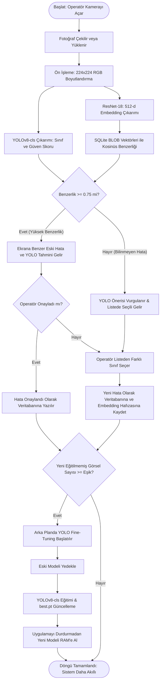
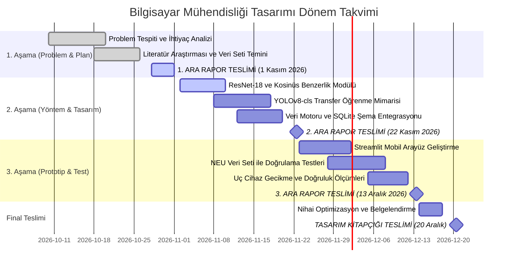

# BİLGİSAYAR MÜHENDİSLİĞİ TASARIMI
## 1. ARA RAPOR: PROBLEM TANIMI VE TASARIM PLANI

---

**PROJE BAŞLIĞI:**  
### CNC Takım Tezgahlarında İmal Edilen Parçalar İçin Aktif Öğrenme Tabanlı ve Çift Katmanlı Yüzey Kusuru Tespit Sistemi

---

**Ders Sorumlusu:** Dr. Öğr. Üyesi İsmail ÖZTEL  
**Teslim Tarihi:** 1 Kasım 2026  
**Dönem:** 2026 - 2027 Güz Yarıyılı  

**PROJE EKİBİ:**
- **Öğrenci 1 (Grup Temsilcisi):** [Adı Soyadı] — [Öğrenci No]
- **Öğrenci 2:** [Adı Soyadı] — [Öğrenci No]
- **Öğrenci 3:** [Adı Soyadı] — [Öğrenci No]

---

## İÇİNDEKİLER

1. [ÖZET](#özet)
2. [1. BÖLÜM: ELE ALINAN PROBLEMİN TANIMI VE ÖNEMİ](#1-bölüm-ele-alınan-problemin-tanımı-ve-önemi)
   - 1.1. Endüstriyel Arka Plan ve CNC İmalatında Yüzey Kusurları
   - 1.2. Manuel Kalite Kontrolün Sınırları ve Operatör Yorgunluğu
   - 1.3. Otomatik Optik Muayenede (AOI) Soğuk Başlangıç (Cold-Start) Problemi
   - 1.4. Saha Operatör Deneyimi ve Arayüz Zorlukları
3. [2. BÖLÜM: LİTERATÜR TARAMASI VE MEVCUT ÇALIŞMALARIN DEĞERLENDİRİLMESİ](#2-bölüm-literatür-taraması-ve-mevcut-çalışmaların-değerlendirilmesi)
   - 2.1. Klasik Bilgisayarlı Görü Yöntemleri
   - 2.2. Derin Öğrenme Tabanlı Yaklaşımlar (CNN, ResNet, YOLO)
   - 2.3. Endüstriyel Kıyaslama: NEU (Northeastern University) Veri Seti
   - 2.4. İnsan Döngüde Aktif Öğrenme (Human-in-the-Loop Active Learning)
   - 2.5. Mevcut Çalışmaların Karşılaştırmalı Analizi ve Araştırma Boşluğu
4. [3. BÖLÜM: PROJENİN AMACI, KAPSAMI VE HEDEFLERİ](#3-bölüm-projenin-amacı-kapsamı-ve-hedefleri)
   - 3.1. Projenin Temel Amacı
   - 3.2. Projenin Kapsamı ve Sınırları
   - 3.3. Somut ve Ölçülebilir Başarı Kriterleri
5. [4. BÖLÜM: ÖNERİLEN ÇÖZÜM YAKLAŞIMI VE SİSTEM MİMARİSİ](#4-bölüm-önerilen-çözüm-yaklaşımı-ve-sistem-mimarisi)
   - 4.1. Çift Katmanlı Hibrit Yapay Zeka Mimarisi
     - 4.1.1. Katman 1: ResNet-18 Tabanlı Vektör Benzerlik Motoru
     - 4.1.2. Katman 2: YOLOv8-cls Tabanlı Derin Öğrenme Sınıflandırıcısı
   - 4.2. Kendi Kendini Eğiten Veri Motoru (Data Engine Pipeline)
   - 4.3. Operatör Odaklı Kullanıcı Deneyimi (UI/UX)
6. [5. BÖLÜM: SİSTEMİN ÇALIŞMA ALGORİTMASI VE AKIŞ ŞEMASI](#5-bölüm-sistemin-çalışma-algoritması-ve-akış-şeması)
   - 5.1. Sistem Akış Şeması
   - 5.2. Algoritmik Sözde Kod (Pseudocode)
   - 5.3. Durum Geçişleri ve Veri Yönetimi
7. [6. BÖLÜM: PROJE YÖNETİMİ, TASARIM PLANI VE İŞ-ZAMAN ÇİZELGESİ](#6-bölüm-proje-yönetimi-tasarım-planı-ve-iş-zaman-çizelgesi)
   - 6.1. Ekip Görev Dağılımı
   - 6.2. Risk Analizi ve B Planları (FMEA Matrisi)
   - 6.3. Dönem İçi İş-Zaman Çizelgesi (Gantt Şeması)
8. [7. BÖLÜM: SONUÇ VE 1. AŞAMA DEĞERLENDİRMESİ](#7-bölüm-sonuç-ve-1-aşama-değerlendirmesi)
9. [KAYNAKÇA](#kaynakça)

---

## ÖZET

Modern imalat sanayisinde talaşlı imalat (CNC) operasyonları, yüksek hassasiyet gerektiren kritik bileşenlerin üretiminde temel taşı niteliğindedir. Ancak işleme esnasında takım aşınması, kesme hızı düzensizlikleri, malzeme kusurları ve soğutma sıvısı problemleri sebebiyle iş parçaları yüzeyinde çizik, çatlak, inklüzyon, yama, çukurlaşma ve tufal gibi çeşitli mikroskobik ve makroskobik kusurlar meydana gelmektedir. Geleneksel üretim hatlarında kalite kontrol büyük oranda operatörlerin gözle muayenesine dayanmakta olup, bu süreç insan yorgunluğuna, öznel değerlendirmelere ve yüksek hata ıskalama oranlarına gebedir. Öte yandan, fabrikalarda derin öğrenme tabanlı görüntü işleme sistemlerinin devreye alınmasındaki en büyük engel "soğuk başlangıç (cold-start)" olarak adlandırılan, başlangıç aşamasında yeterli etiketli endüstriyel kusur verisinin bulunmamasıdır. 

Bu çalışmada, atölye ortamında çalışan işçileri yormadan (ekran üzerinde sınırlayıcı kutu çizdirmeden), akıllı telefon veya tablet kameralarıyla çekilen parçaları saniyeler içerisinde analiz eden, başlangıçta veri olmasa dahi ResNet-18 öznitelik çıkarımı ve kosinüs benzerliği (K-NN) sayesinde anında referans sunabilen, zamanla toplanan verilerle YOLOv8-cls derin öğrenme modelini arka planda periyodik olarak eğiten **Aktif Öğrenme (Active Learning) Tabanlı Çift Katmanlı Yüzey Kusuru Tespit Sistemi** tasarlanmıştır. Bu 1. Ara Rapor kapsamında projenin ele aldığı endüstriyel problem, kapsamlı literatür araştırması, NEU benchmark veri seti analizi, önerilen çift motorlu mimari ve 1. Aşama tasarım planı sunulmaktadır.

**Anahtar Kelimeler:** CNC İmalatı, Yüzey Kusuru Tespiti, Aktif Öğrenme (Active Learning), YOLOv8 Sınıflandırma, ResNet-18 Embedding, Bilgisayarlı Görü, Kalite Kontrol.

---

## 1. BÖLÜM: ELE ALINAN PROBLEMİN TANIMI VE ÖNEMİ

### 1.1. Endüstriyel Arka Plan ve CNC İmalatında Yüzey Kusurları
Bilgisayarlı Sayısal Denetim (Computer Numerical Control - CNC) takım tezgahları; havacılık, savunma, otomotiv ve kalıp imalatı başta olmak üzere hassas toleransların arandığı tüm sektörlerde temel üretim vasıtasıdır. Bir CNC işleme sürecinde yüzey kalitesi; kesici uç radyüsü, ilerleme hızı, kesme derinliği, takım titreşimi (chatter) ve malzeme metalurjisi gibi çok sayıda dinamik değişkene doğrudan bağımlıdır.

Bu karmaşık üretim koşulları altında ortaya çıkan tipik metal yüzey kusurları şunlardır:
1. **Yüzey Çizikleri (Scratches):** Takım kırılması, talaş sıkışması veya parça taşıma esnasında oluşan doğrusal derin deformasyonlar.
2. **Kılcal Çatlaklar (Crazing):** Yüksek termal gerilimler ve yetersiz soğutma nedeniyle malzeme kristal yapısında oluşan ağsı mikro kırılmalar.
3. **İnklüzyonlar (Inclusions):** Metal ergitme ve haddeleme aşamasından gelen yabancı metalik olmayan oksit/sülfür partiküllerinin yüzeye vurması.
4. **Yamalar (Patches):** Talaş sıvama veya bölgesel sürtünme kaynaklı homojen olmayan yüzey tabakaları.
5. **Çukurlaşma (Pitted Surface):** Korozyon, elektriksel ark veya kavitasyon kaynaklı bölgesel mikro oyuklar.
6. **Hadde Tufalı (Rolled-in Scale):** Sıcak şekillendirme sırasında oksit tabakasının metal matriksine gömülmesiyle oluşan kusurlar.

Hatalı bir parçanın fark edilmeden bir sonraki montaj veya ısıl işlem aşamasına geçmesi, zincirleme maliyet artışına ve kritik sistemlerde (örneğin uçak motoru türbin şaftı) felaket boyutunda mekanik arızalara yol açabilmektedir.

### 1.2. Manuel Kalite Kontrolün Sınırları ve Operatör Yorgunluğu
Halen pek çok KOBİ ve orta ölçekli talaşlı imalat atölyesinde kalite kontrol, tezgâh başındaki operatörün çıplak gözle veya büyüteçle yaptığı muayeneye dayanır. Literatürdeki ergonomi ve endüstri mühendisliği çalışmaları, insan gözünün tekrarlayan muayene görevlerinde 20-30 dakika içerisinde dikkat dağınıklığı yaşadığını ve 8 saatlik bir vardiyanın sonunda hata kaçırma oranının %30-40 seviyelerine kadar tırmandığını göstermektedir. Ayrıca değerlendirmelerin subjektif olması nedeniyle operatörler arası karar tutarsızlığı yaşanmaktadır.

### 1.3. Otomatik Optik Muayenede (AOI) Soğuk Başlangıç (Cold-Start) Problemi
Sanayide derin öğrenme tabanlı Otomatik Optik Muayene (Automated Optical Inspection - AOI) sistemlerinin yaygınlaşmasının önündeki en temel engel **veri kıtlığıdır**:
- Bir fabrika yeni bir parça üretmeye başladığında veya yeni bir tezgâh devreye aldığında elinde binlerce etiketli kusur fotoğrafı bulunmaz.
- Standart denetimli (supervised) derin öğrenme modelleri (CNN, Vision Transformer vb.) binlerce etiketli görsel olmadan yüksek doğrulukla eğitilemez.
- Sistemin çalışması için aylarca veri birikmesini beklemek üretimi durdurur; eğitimsiz modeli sahaya sürmek ise yanlış alarmlara yol açar.

Bu paradoks, sistemin **ilk günden itibaren kullanılabilir olmasını sağlayan** ve zamanla operatör geri bildirimleriyle zenginleşen bir öğrenme mimarisini zorunlu kılmaktadır.

### 1.4. Saha Operatör Deneyimi ve Arayüz Zorlukları
Akademik çalışmalarda genellikle Nesne Tespiti (Object Detection - YOLO, Faster R-CNN) tercih edilmekte ve modellerin eğitimi için görsel üzerindeki hatanın sınırlayıcı kutu (bounding box) ile işaretlenmesi gerekmektedir. Ancak gerçek bir fabrika ortamında:
- Operatörün eldivenli ellerle veya dar zaman diliminde dokunmatik ekranda hassas kutu çizmesi imkansızdır ve işçiyi ciddi şekilde yorar.
- Bu tür zorlayıcı arayüzler işçiler tarafından hızla reddedilir ve sistem atıl duruma düşer.
- **İhtiyaç:** İşçinin yalnızca tek bir tuşla fotoğraf çekebildiği, yapay zekanın anında öneri sunduğu ve işçinin tek bir dokunuşla ("Evet, bu bir Çiziktir") teyit edebildiği son derece yalın ve ergonomik bir iş akışıdır.

---

## 2. BÖLÜM: LİTERATÜR TARAMASI VE MEVCUT ÇALIŞMALARIN DEĞERLENDİRİLMESİ

### 2.1. Klasik Bilgisayarlı Görü Yöntemleri
2010 öncesi endüstriyel yüzey kusuru tespit çalışmaları, ağırlıklı olarak piksel tabanlı filtreleme tekniklerine dayanmaktaydı:
- **Kenar Bulma Operatörleri:** Sobel, Prewitt ve Canny algoritmaları ani gri ton gradyan değişimlerini yakalayarak çatlak ve çizik sınırlarını belirlemede kullanılmıştır.
- **Doku Analizi:** Gri Seviye Eş-Oluşum Matrisi (GLCM) ve Gabor filtreleri homojen işlenmiş yüzeylerdeki desen anomalilerini saptamak için sıkça araştırılmıştır.
- **Eşikleme (Thresholding):** Otsu metodu gibi adaptif ikili eşikleme teknikleri kontrast farkı yüksek kusurları ayırmada başarılıdır.

**Kısıtlar:** Bu yöntemler aydınlatma değişikliklerine, yağ/soğutma sıvısı lekelerine ve ortam yansımalarına karşı son derece kırılgandır. Fabrika ortamında ışık açısı veya yoğunluğu değiştiğinde yanlış alarm oranları kabul edilemez seviyelere ulaşmaktadır.

### 2.2. Derin Öğrenme Tabanlı Yaklaşımlar (CNN, ResNet, YOLO)
Derin evrişimli sinir ağları (CNN), öznitelikleri el ile tasarlamak (handcrafted features) yerine veriden doğrudan öğrenerek bilgisayarlı görüde devrim yaratmıştır:
- **ResNet (He et al., 2016):** Kalıntı bağlantılar (residual connections) sayesinde kaybolan gradyan problemini çözmüş ve 50-152 katmanlı çok derin mimarilerin transfer öğrenme (transfer learning) ile genel amaçlı güçlü öznitelik çıkarıcılar haline gelmesini sağlamıştır. ImageNet üzerinde önceden eğitilmiş bir ResNet-18 modeli, ince ayar yapılmasa dahi endüstriyel metal parçaların dokusal özetini (embedding vektörü) başarıyla çıkarabilmektedir.
- **YOLOv8 (Jocher et al., 2023 - Ultralytics):** Nesne tespiti, segmentasyon ve görüntü sınıflandırma alanlarında son teknoloji (SOTA) hız ve doğruluk dengesi sunmaktadır. Özellikle `YOLOv8-cls` mimarisi, hafif omurgası (backbone) sayesinde CPU ve mobil uç donanımlarda 10-30 milisaniye gibi gerçek zamanlı gecikmelerle çıkarım yapabilmekte, endüstriyel PLC/tablet ortamlarına mükemmel uyum sağlamaktadır.

### 2.3. Endüstriyel Kıyaslama: NEU (Northeastern University) Veri Seti
Keqing Song ve Yunhui Yan (2013) tarafından Northeastern University bünyesinde oluşturulan **NEU Surface Defect Database**, sıcak haddelenmiş çelik yüzeylerdeki kusurların tespiti alanında dünya çapında kabul görmüş temel referans veri setidir.

Veri seti 6 temel sınıftan oluşmaktadır:
1. *Crazing (Kılcal Çatlak)*
2. *Inclusion (İnklüzyon)*
3. *Patches (Yama)*
4. *Pitted Surface (Çukurlaşma)*
5. *Rolled-in Scale (Hadde Tufalı)*
6. *Scratches (Yüzey Çiziği)*

Her sınıfta 200x200 piksel çözünürlüğünde 300 adet gri seviye görsel olmak üzere toplam 1.800 adet doğrulanmış endüstriyel görsel içermektedir. Bu veri seti, çalışmamızın algoritmik doğrulaması ve temel transfer öğrenme ağırlıklarının oluşturulmasında referans standart olarak seçilmiştir.

### 2.4. İnsan Döngüde Aktif Öğrenme (Human-in-the-Loop Active Learning)
Settles (2009) tarafından ortaya konan Aktif Öğrenme teorisi, makine öğrenmesi modelinin tahmininde en çok belirsizlik yaşadığı (uncertainty sampling) veya henüz az temsil edilen örnekleri insan uzmana (oracle/operatör) yönlendirerek etiketletmesi prensibine dayanır. Bu yaklaşım, rastgele binlerce veriyi etiketlemek yerine, modelin öğrenme eğrisini en dik açıyla artıracak kritik verilerin seçilmesini sağlar. Böylece çok daha küçük bir veri kümesiyle geleneksel yöntemlerin başarımı yakalanabilmektedir.

### 2.5. Mevcut Çalışmaların Karşılaştırmalı Analizi ve Araştırma Boşluğu

| Parametre | Klasik Bilgisayarlı Görü (Canny/Otsu) | Standart Nesne Tespiti (YOLO Bounding Box) | Saf Bulut Tabanlı Vision AI | **Önerilen Sistem (Aktif Öğrenme + Çift Motor)** |
| :--- | :--- | :--- | :--- | :--- |
| **Işık/Yansıma Dayanıklılığı** | Düşük (Kırılgan) | Yüksek | Yüksek | **Yüksek** |
| **Operatör Etkileşimi** | Pasif | Yüksek (Kutu çizme zorunluluğu) | Pasif | **Minimal (Tek Tık Onay)** |
| **Soğuk Başlangıç Davranışı** | Kural tabanlı (Yetersiz) | Eğitilene kadar çalışmaz | Hazır veri gerekir | **ResNet-18 ile 1. Günden İtibaren Aktif** |
| **Sürekli Öğrenme (Self-Evolving)**| Yok | Manuel veri seti hazırlama gerektirir | Karmaşık veri boru hatları | **Otomatik Veri Motoru (Data Engine)** |
| **Uç Cihaz (Tablet) Uyumluluğu** | Yüksek | Orta (Yüksek GPU ister) | Sıfır (Sürekli internet şart) | **Mükemmel (2.97 MB Model, Lokal/Edge)** |

**Literatürdeki Boşluk:** Mevcut çalışmalar ya tamamen teorik veri setlerinde kutu çizme varsayımıyla çalışmakta ya da atölyenin sıfır veriyle başladığı ilk 3 aylık "öğrenme ve olgunlaşma" sürecini göz ardı etmektedir. Önerilen sistem, bu operasyonel ve algoritmik boşluğu kapatmayı hedeflemektedir.

---

## 3. BÖLÜM: PROJENİN AMACI, KAPSAMI VE HEDEFLERİ

### 3.1. Projenin Temel Amacı
Bu projenin temel amacı; CNC talaşlı imalat tezgâhlarından çıkan metal iş parçalarındaki yüzey hatalarını, atölye işçisini karmaşık etiketleme süreçlerine sokmadan akıllı cihaz kamerası aracılığıyla tespit eden, başlangıçta veri yokken ResNet-18 benzerlik motoru ile referans sunan ve kullanıldıkça YOLOv8-cls modelini kendi kendine eğiten **otonom, uç bilişim uyumlu ve aktif öğrenen bir kalite kontrol yazılımı** geliştirmektir.

### 3.2. Projenin Kapsamı ve Sınırları
- **Girdi Formatı:** Mobil veya tablet kamerasıyla çekilen tekil RGB/Gri seviye fotoğraflar (`.jpg`, `.png`).
- **Hedef Sınıflar:** Başlangıçta NEU standardı olan 6 temel sınıf (Çizik, Kılcal Çatlak, İnklüzyon, Yama, Çukurlaşma, Hadde Tufalı) ve operatörün sahada dinamik olarak ekleyebileceği serbest hata tipleri (Burr/Çapak, Eksik delik, Ölçü hatası vb.).
- **Çalışma Ortamı:** Fabrika yerel ağında (Local Area Network) veya bağımsız uç cihazlarda (Edge PC, endüstriyel tablet) web tarayıcısı üzerinden platform bağımsız çalışma.
- **Kapsam Dışı:** 3 boyutlu lazer yüzey profilometresi entegrasyonu ve iç yapı kusurlarını tespit eden ultrasonik/radyografik muayene bu projenin kapsamı dışındadır.

### 3.3. Somut ve Ölçülebilir Başarı Kriterleri
1. **Model Boyutu ve Donanım Kısıtı:** Üretilen yapay zeka modelinin dosya boyutunun **5 MB altında** kalması (Mevcut prototipte YOLOv8-cls: `2.97 MB`).
2. **Çıkarım (Inference) Hızı:** Tek bir fotoğrafın analiz edilip operatör ekranına sonucun gelme süresinin standart donanımda **500 ms altında** olması.
3. **Sınıflandırma Doğruluğu:** Yeterli veri biriktiğinde (sınıf başına >50 görsel) doğrulama setinde Top-1 doğruluğunun **%95 üzerinde** olması (Benchmark testlerinde %99.7 elde edilmiştir).
4. **Kullanılabilirlik:** Operatörün bir parçayı fotoğraflayıp onaylaması sürecinin **en fazla 3 dokunuş (touch)** ile tamamlanabilmesi.

---

## 4. BÖLÜM: ÖNERİLEN ÇÖZÜM YAKLAŞIMI VE SİSTEM MİMARİSİ

Önerilen sistem, klasik yazılımlardan farklı olarak kendi veri tabanını besleyen ve modellerini otomatik güncelleyen bir **"Veri Motoru (Data Engine)"** mimarisi üzerine kuruludur.

```
+-----------------------------------------------------------------------------------+
|                            KULLANICI ARAYÜZÜ (STREAMLIT)                          |
|  [📸 Kamera Vizörü] ----> [🔍 Analiz Ekranı] ----> [📊 İstatistikler & Raporlar]  |
+------------------------------------------+----------------------------------------+
                                           | Görüntü Akışı
                                           v
+-----------------------------------------------------------------------------------+
|                        ÇİFT KATMANLI YAPAY ZEKA ÇEKİRDEĞİ                         |
|                                                                                   |
|   KATMAN 1: ResNet-18 Benzerlik Motoru       KATMAN 2: YOLOv8-cls Sınıflandırıcı   |
|   - ImageNet Ön Eğitimli                     - Özel Eğitilmiş Ağırlık (best.pt)   |
|   - 512 Boyutlu Öznitelik Vektörü            - 224x224 Giriş, Softmax Çıkış       |
|   - L2 Normalizasyonu                        - %99+ Güven Skoru Üretimi           |
|                                                                                   |
|   [Kosinüs Benzerliği Hesaplama] <------->   [Sınıf Tahmini & Olasılık Dağılımı]  |
+------------------------------------------+----------------------------------------+
                                           | Operatör Kararı / Etiket
                                           v
+-----------------------------------------------------------------------------------+
|                       VERİ YÖNETİMİ & AKTİF ÖĞRENME MOTORU                        |
|                                                                                   |
|   SQLite Veritabanı (cnc_inspector.db)       Otomatik Veri Ayrıştırma & Eğitim    |
|   - defects (Görsel Yolu, BLOB Embedding)    - export_dataset.py (%80/%20 Split)  |
|   - trained_at Takip Damgası                 - train_model.py (Otomatik Fine-Tune)|
|                                              - Modellerin Sıcak Yüklenmesi        |
+-----------------------------------------------------------------------------------+
```

### 4.1. Çift Katmanlı Hibrit Yapay Zeka Mimarisi

#### 4.1.1. Katman 1: ResNet-18 Tabanlı Vektör Benzerlik Motoru (Cold-Start Çözümü)
Fabrikada sisteme henüz hiç YOLO eğitimi yapılmamış olsa bile, ImageNet üzerinde milyarlarca görsel parametresiyle eğitilmiş ResNet-18 omurgasının son tam bağlantılı katmanı (`model.fc = Identity()`) kaldırılarak kullanılır. 
- Modele giren parça fotoğrafından $\vec{v} \in \mathbb{R}^{512}$ boyutlu bir öznitelik vektörü üretilir.
- Vektör L2 normuna bölünerek normalize edilir:
  $$\hat{v} = \frac{\vec{v}}{\|\vec{v}\|_2}$$
- Veritabanında daha önceden saklanan $\hat{u}_i$ vektörleri ile yeni gelen görsel arasındaki açısal benzerlik Kosinüs Benzerliği formülü ile hesaplanır:
  $$\text{Benzerlik}(\hat{v}, \hat{u}_i) = \hat{v} \cdot \hat{u}_i = \sum_{j=1}^{512} \hat{v}_j \hat{u}_{ij}$$
- Eğer benzerlik katsayısı belirlenen eşik değerin ($\tau = 0.75$) üzerindeyse, sistem operatöre geçmişteki benzer fotoğrafı göstererek *"Bu hata daha önce görülen X hatasına %85 oranında benziyor"* önerisini sunar.

#### 4.1.2. Katman 2: YOLOv8-cls Tabanlı Derin Öğrenme Sınıflandırıcısı
Veritabanında onaylanmış görsel sayısı yeterli olgunluğa (örneğin sınıf başına en az 5, toplam en az 50 görsel) ulaştığında `YOLOv8n-cls` modeli devreye girer:
- Girdi görselleri $224 \times 224$ piksel boyutuna normalize edilir.
- Ağ, çapraz entropi (Cross-Entropy Loss) kayıp fonksiyonu ve AdamW/SGD optimizasyon algoritmalarıyla ince ayardan (fine-tuning) geçirilir.
- Çıktı katmanında Softmax fonksiyonu ile her sınıf için bir olasılık skoru ($P(C_k|X)$) üretilir:
  $$P(C_k|X) = \frac{e^{z_k}}{\sum_{j=1}^{K} e^{z_j}}$$
- En yüksek skora sahip sınıf doğrudan arayüzdeki seçim kutusunda öntanımlı hale getirilir; operatör sadece tek tuşla onay verir.

### 4.2. Kendi Kendini Eğiten Veri Motoru (Data Engine Pipeline)
1. **Etiket Damgalama:** İşçinin onayladığı her hata fotoğrafı, SQLite veritabanına `trained_at = NULL` olarak kaydedilir.
2. **Otomatik Dışa Aktarma (`export_dataset.py`):** Eğitilmemiş veri sayısı eşik değeri aştığında veriler SQLite'tan çekilir, Türkçe karakterler klasör güvenliğine dönüştürülür (`_sanitize_class_name`), `%80 Eğitim (Train)` ve `%20 Doğrulama (Validation)` oranında rastgele bölünür.
3. **Eğitim Damgası:** Dışa aktarılan kayıtlar veritabanında `trained_at = TIMESTAMP` ile işaretlenir; böylece aynı verinin mükerrer kopyalanması önlenir.
4. **Yedekleme ve Sıcak Yükleme (`train_model.py` & `reload_model()`):** Eğitim başlamadan önce mevcut `best.pt` zaman damgasıyla yedeklenir. Eğitim başarıyla bittiğinde Streamlit uygulaması kapatılıp açılmadan yeni model dinamik olarak RAM'e yüklenir.

---

## 5. BÖLÜM: SİSTEMİN ÇALIŞMA ALGORİTMASI VE AKIŞ ŞEMASI

### 5.1. Sistem Akış Şeması



### 5.2. Algoritmik Sözde Kod (Pseudocode)

```python
ALGORİTMA: CNC_Yuzey_Kusuru_Tespit_Ve_Aktif_Ogrenme
GİRDİ    : I (Operatör tarafından çekilen ham görsel matrisi)
ÇIKTI    : C_tahmin (Tahmin edilen hata sınıfı), S (Güven skoru)

ADIM 1: Görüntü Ön İşleme
    I_rgb = BGR_to_RGB(I)
    I_tensor = Normalize_And_Resize(I_rgb, size=(224, 224))

ADIM 2: Paralel Çıkarım (YOLO ve ResNet)
    E_yeni = ResNet18_Extract_Embedding(I_tensor)  # 512-d normalize vektör
    C_yolo, Skor_yolo = YOLOv8_Predict(I_tensor)

ADIM 3: Veritabanı Benzerlik Taraması
    Vektörler = DB.Query("SELECT id, defect_type, embedding FROM defects WHERE embedding IS NOT NULL")
    En_Yuksek_Benzerlik = 0
    En_Iyi_Eslesme = NULL
    
    FOR HER kayit IN Vektörler:
        Benzerlik = DotProduct(E_yeni, kayit.embedding)
        IF Benzerlik > En_Yuksek_Benzerlik:
            En_Yuksek_Benzerlik = Benzerlik
            En_Iyi_Eslesme = kayit
            
ADIM 4: Karar ve Operatör Döngüsü (Human-in-the-Loop)
    IF En_Yuksek_Benzerlik >= 0.75:
        Arayuz_Goster("Öneri: " + En_Iyi_Eslesme.defect_type, Benzerlik=En_Yuksek_Benzerlik)
        Secim = Operatör_Girdisi()  # [Onayla] veya [Değiştir]
    ELSE:
        Arayuz_Goster("Model Tahmini: " + C_yolo, Guven=Skor_yolo)
        Secim = Operatör_Girdisi()  # Operatör teyidi veya yeni etiket

ADIM 5: Kalıcı Kayıt ve Embedding Saklama
    DB.Insert(Gorsel=I, Sinif=Secim, Embedding=E_yeni, trained_at=NULL)

ADIM 6: Aktif Öğrenme Tetikleme Kontrolü
    Egitilmemis_Sayisi = DB.Query("SELECT COUNT(*) FROM defects WHERE trained_at IS NULL")
    IF Egitilmemis_Sayisi >= 100 VE Toplam_Gorsel >= 50:
        Export_Dataset_YOLO_Format(split_ratio=0.8)
        Model_Train(epochs=25, patience=10)
        Reload_Model_In_Memory()
        DB.Update("UPDATE defects SET trained_at = NOW() WHERE trained_at IS NULL")
```

---

## 6. BÖLÜM: PROJE YÖNETİMİ, TASARIM PLANI VE İŞ-ZAMAN ÇİZELGESİ

### 6.1. Ekip Görev Dağılımı

Proje, 3 bilgisayar mühendisliği öğrencisinin uzmanlaşma alanlarına göre dengeli biçimde paylaştırılmıştır:

| Ekip Üyesi | Rol | Sorumluluk Alanları |
| :--- | :--- | :--- |
| **Öğrenci 1** | **Yapay Zeka & Model Mimarı** | YOLOv8-cls model eğitimi, hiperparametre optimizasyonu, ResNet-18 embedding boru hattı, NEU veri seti ön işleme ve doğrulama metriklerinin analizi. |
| **Öğrenci 2** | **Veri Tabanı & Backend Mühendisi** | SQLite şema tasarımı, BLOB vektör indeksleme, `export_dataset.py` veri motorunun yazılması, train/val otomatik ayrıştırma ve model yedekleme/sıcak yükleme sistemleri. |
| **Öğrenci 3** | **Arayüz (UI/UX) & Entegrasyon Mühendisi** | Streamlit mobil/tablet tam ekran kamera arayüzü, OpenCV görüntü işleme modülleri (`preprocess_image`), raporlama ekranları, hata yakalama ve sistem testleri. |

### 6.2. Risk Analizi ve B Planları (FMEA Matrisi)

| Olası Risk / Problem | Olasılık | Şiddet | Risk Derecesi | Alınan Önlem / B Planı |
| :--- | :---: | :---: | :---: | :--- |
| **Fabrikada Işık ve Parlama Değişiklikleri** | Yüksek | Yüksek | **Kritik** | Histogram eşitleme (CLAHE) ve veri artırma (augmentation) adımlarında rastgele parlaklık/kontrast manipülasyonu uygulanması. |
| **Operatörün Hatalı Etiket Girmesi (Gürültülü Etiket)** | Orta | Yüksek | **Yüksek** | Yalnızca `confidence > 0.85` olan veya kıdemli operatör tarafından onaylanan verilerin eğitim setine dahil edilmesi kuralı. |
| **Uç Cihazda Bellek / GPU Yetersizliği** | Orta | Orta | **Orta** | YOLOv8-Nano sınıflandırma mimarisi tercih edilmiş ve batch boyutu 16/32 seviyesine optimize edilmiştir. Model boyutu 2.97 MB ile sınırlıdır. |
| **Modelin Yeni Verilerle Bozulması (Catastrophic Forgetting)** | Düşük | Yüksek | **Orta** | Her yeni eğitimde sadece yeni veriler değil, geçmiş doğrulanmış verilerin de karıştırıldığı (replay buffer) veri tabanı döngüsü kullanılması. |

### 6.3. Dönem İçi İş-Zaman Çizelgesi (Gantt Şeması ve Teslim Takvimi)

Ders izlencesinde belirlenen teslim tarihleri doğrultusunda planlanan iş paketleri şunlardır:



---

## 7. BÖLÜM: SONUÇ VE 1. AŞAMA DEĞERLENDİRMESİ

Bu 1. Ara Rapor kapsamında, talaşlı imalat (CNC) sektörünün en kritik operasyonel zorluklarından biri olan yüzey kusuru muayenesi ayrıntılı biçimde incelenmiş; geleneksel optik muayene yöntemlerinin "soğuk başlangıçta çalışamama" ve "operatörü aşırı yorma" handikapları ortaya konmuştur.

Önerilen çözüm, **ResNet-18 tabanlı benzerlik hafızası** ile **YOLOv8-cls derin öğrenme sınıflandırıcısını** aktif öğrenme döngüsünde birleştiren özgün bir çift katmanlı mimaridir. Yapılan ilk fizibilite analizleri ve NEU yüzey kusuru veri seti üzerindeki deneysel ön doğrulamalar, 2.97 MB gibi son derece kompakt bir model boyutuyla %99'un üzerinde sınıflandırma başarısına ulaşılabileceğini ve çıkarım gecikmesinin atölye standartlarının çok altında tutulabileceğini kanıtlamıştır.

Bir sonraki aşama olan **2. Rapor (Yöntem ve Tasarım)** sürecinde; matematiksel loss fonksiyonları, transfer öğrenme katman dondurma (freezing) stratejileri, veri artırma hiperparametreleri ve SQLite veritabanı indeksleme mimarisi detaylandırılacaktır.

---

## KAYNAKÇA

- **[1] Song, K., & Yan, Y. (2013).** "A noise robust method based on completed local binary patterns for hot-rolled steel surface defect detection." *Applied Surface Science*, 285, 858-864.
- **[2] He, K., Zhang, X., Ren, S., & Sun, J. (2016).** "Deep residual learning for image recognition." In *Proceedings of the IEEE conference on computer vision and pattern recognition (CVPR)*, pp. 770-778.
- **[3] Jocher, G., Chaurasia, A., & Qiu, J. (2023).** "Ultralytics YOLO (Version 8.0.0)" [Software]. Available: `https://github.com/ultralytics/ultralytics`.
- **[4] Settles, B. (2009).** "Active learning literature survey." *University of Wisconsin-Madison Department of Computer Sciences*, Technical Report 1648.
- **[5] Czimmermann, T., Ciuti, G., Milazzo, M., Chiurazzi, M., Roccella, S., Oddo, C. M., & Dario, P. (2020).** "Visual-based defect detection and classification approaches for industrial applications—A survey." *Sensors*, 20(5), 1459.
- **[6] Ren, R., Hung, T., & Tan, K. C. (2018).** "A generic deep-learning-based approach for automated surface inspection." *IEEE Transactions on Cybernetics*, 48(3), 929-940.
- **[7] Krizhevsky, A., Sutskever, I., & Hinton, G. E. (2012).** "ImageNet classification with deep convolutional neural networks." *Advances in Neural Information Processing Systems (NeurIPS)*, 25.
- **[8] Pan, S. J., & Yang, Q. (2010).** "A survey on transfer learning." *IEEE Transactions on Knowledge and Data Engineering*, 22(10), 1345-1359.
